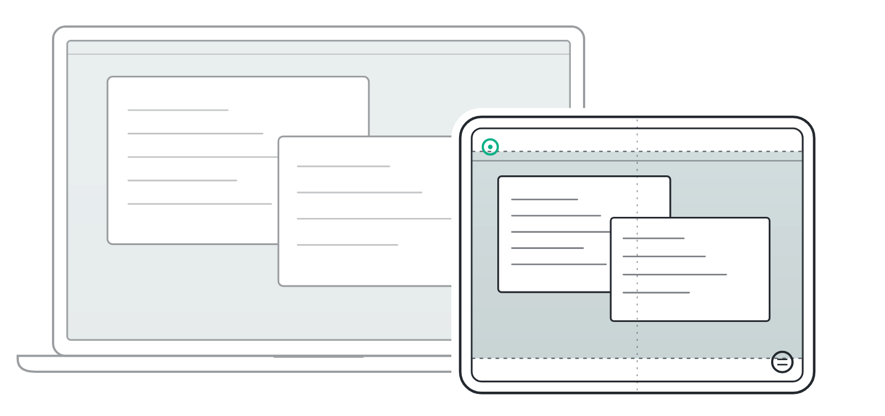
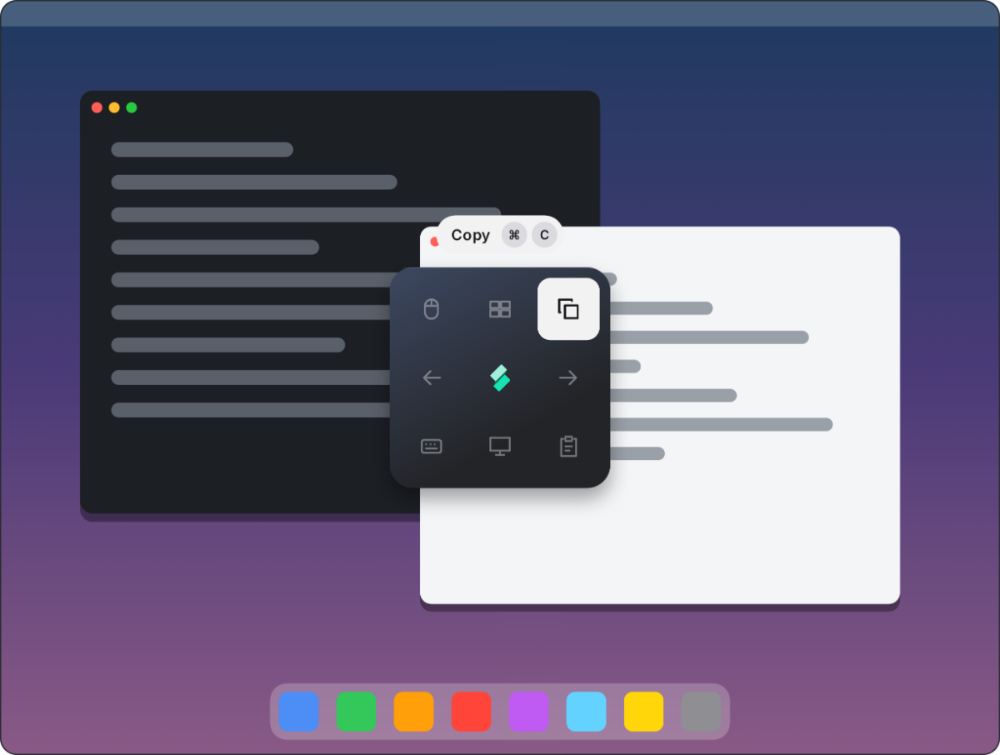

<div align="center">


# Oripane

**A Mac's screen on an Android phone, as a second display or a mirror.**

[Features](#features) · [Building](#building) · [Usage](docs/usage.md) · [Protocol](docs/protocol.md) · [Security](docs/security.md)

[](https://github.com/wadackel/oripane/actions/workflows/android.yml)
[](LICENSE)


</div>

<p align="center">
  <picture>
    <source media="(prefers-color-scheme: dark)" srcset="docs/images/hero-dark.png">
    
  </picture>
</p>

> [!NOTE]
> Oripane is a personal project, built for and tested on one Galaxy Z Fold and one Mac. There are
> no prebuilt apps: [build it from source](#building). Issues and pull requests are not open to
> outside contributors; security reports are welcome through
> [private vulnerability reporting](SECURITY.md).

## Features

### Three ways to show the Mac

- **Extend** adds a virtual display to the Mac in the phone's proportions, a second screen to drag
  windows onto.
- **Mirror** shows the Mac's own screen.
- **Match** is for using the Mac away from it: the Mac's main display becomes a mirror of a display
  in the phone's proportions, so the whole desktop fills the phone without black bars.

The mode switches during a session without reconnecting. Folding, unfolding and rotating the phone
reshape the virtual display to match.

### Low latency on Wi-Fi

The Mac encodes with VideoToolbox in low-latency HEVC (H.264 for a phone without a hardware HEVC
decoder) and sends it over UDP, with parity packets that repair a lost fragment without waiting for
it again. The phone holds Wi-Fi's low-latency lock during a session. A status dot reports latency
and loss, opens into the full readout on a tap, and says so while AWDL (the radio behind AirDrop
and Handoff, which takes Wi-Fi to another channel every few seconds) is on.

### At home and away

On the home Wi-Fi the phone finds the Mac over Bonjour. Away from home it reaches the same Mac over
[Tailscale](https://tailscale.com/), choosing the route on its own and switching back to the LAN
when it is home again. Data saver caps the stream at 4 Mbps off Wi-Fi.

### Touch that drives a Mac

<p align="center"></p>

- **Direct or Trackpad.** Press where the finger is, or move a cursor as on a trackpad.
- **Gestures you choose.** Two-finger scroll and right-click, and four-finger swipes for Mission
  Control and Spaces, as on a Mac trackpad. Each one-shot gesture can be bound to another action,
  separately for each mode.
- **A radial menu** under a resting finger, with up to eight items of your choosing: Mac actions, editing
  keys, or shortcuts of your own.
- **Scroll bands** on the screen's edges in Trackpad mode, for scrolling with the thumb of the hand
  holding the phone.

### Typing

A row of `⌘` `⌥` `⌃` `⇧` `Esc` `Tab` and the arrows sits above the soft keyboard, so `⌘` and `c`
copy on the Mac. Japanese and other IME input is composed on the phone and sent once it is
committed. A Bluetooth keyboard and mouse pass through as they are.

### Paired, and encrypted

A new phone pairs only when the person at the Mac approves it, after comparing a code shown on both.
From authentication on, every message and packet of a session is sealed with AES-GCM under a key
derived from the pairing, and the phone's key never leaves the app's private storage. The details are in [`docs/security.md`](docs/security.md).

## Limitations

> [!IMPORTANT]
> **The virtual display uses a private macOS API** (`CGVirtualDisplay`). A macOS update can break
> Extend and Match until the host is changed to match.

- No audio.
- One phone streams at a time; a second one connecting takes over.
- Away from home the Mac has to be running and unlocked.
- Requires macOS 14 or later and Android 13 or later.

## Building

The Mac side needs the Xcode Command Line Tools. The phone side needs
[Nix](https://nixos.org/download/) with flakes enabled and the Android SDK at
`~/Library/Android/sdk` or wherever `ANDROID_HOME` points; the JDK comes from the flake, and Gradle
from the wrapper.

```sh
git clone https://github.com/wadackel/oripane.git
cd oripane
tools/app install                         # build the menu bar app, sign it, put it in ~/Applications and open it
cd android && ./gw :app:assembleRelease   # ./gw runs the Gradle wrapper inside `nix develop`
adb install -r app/build/outputs/apk/release/app-release.apk
```

`tools/app install` signs the app with a self-signed certificate it keeps in a keychain of its own;
[`docs/security.md`](docs/security.md#same-user-programs) explains what that allows. The first
launch walks through the permissions the Mac needs, and the first connection pairs the phone:
[`docs/usage.md`](docs/usage.md) covers both, and every gesture and setting after that.

[`docs/development.md`](docs/development.md) covers the layout of the code, running the host from a
terminal, the tests, and the emulator tools.

## License

Oripane is released under the [MIT License](LICENSE). The bundled fonts, Inter and Inter Tight, keep
their own licence (the SIL Open Font License), which ships in the APK and is shown on the app's
About page with the notices of the libraries it uses.
